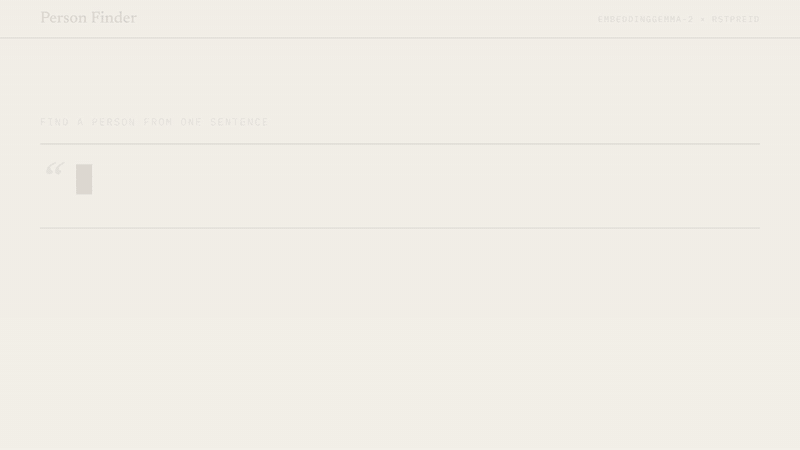
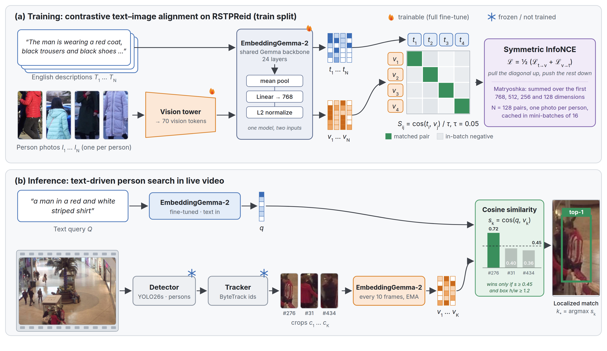
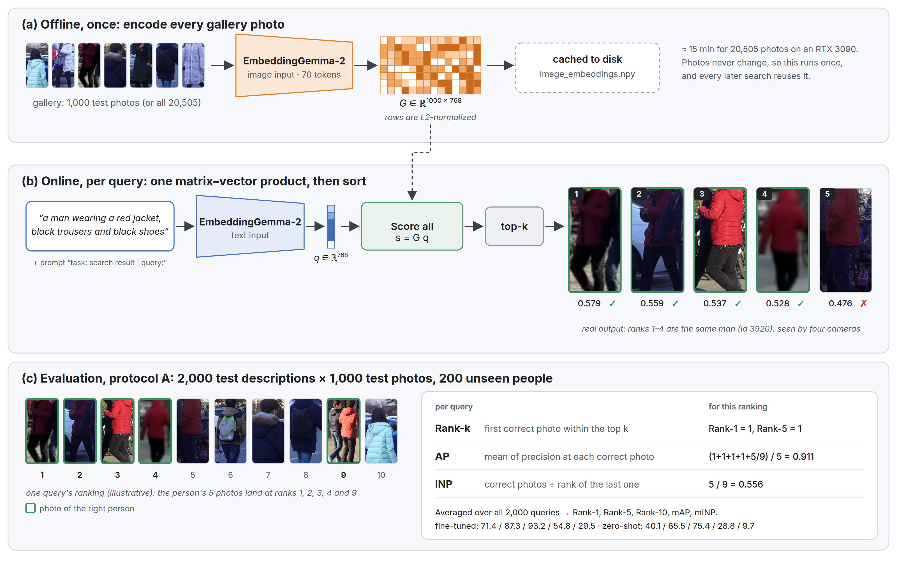
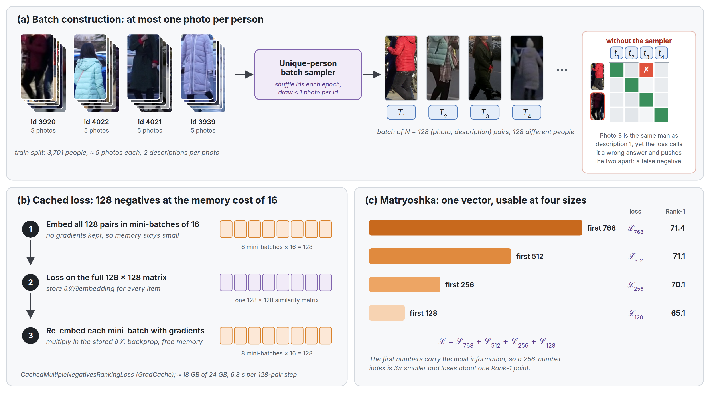
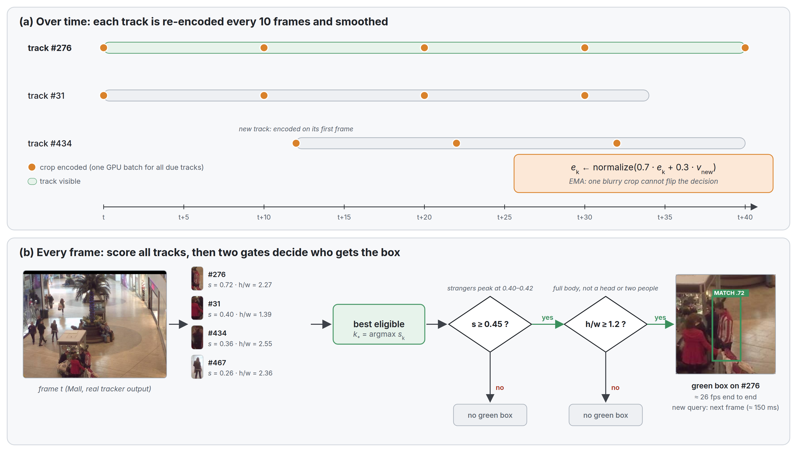
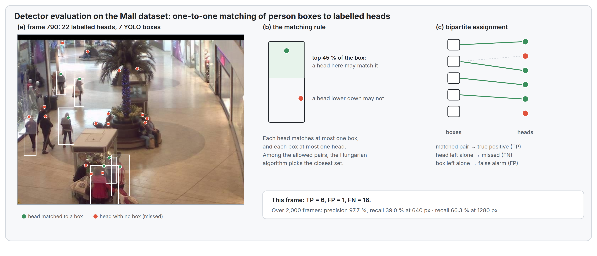
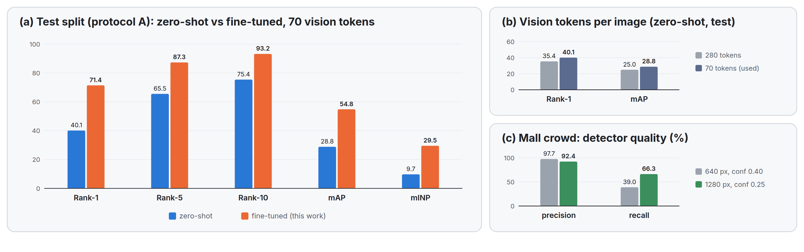

<div align="center">

# Person Finder

**Type one sentence, and it finds the person, in a photo gallery or live in a crowd.**



<sub>Every frame above is real output. The video is made in code with Remotion (<a href="promo/">promo/</a>), and the full-quality MP4 is <a href="docs/media/person-finder.mp4">here</a>.</sub>

</div>

<br>

| | before | after fine-tuning |
|---|:---:|:---:|
| **First guess is the right person** (Rank-1, 200 unseen people) | 40.1% | **71.4%** |
| **Right person on the first screen** (Rank-10) | 75.4% | **93.2%** |
| **Live video**, detect → track → read → box | | **≈ 26 fps** on one RTX 3090 |

## What it is

One embedding model, [EmbeddingGemma-2](https://huggingface.co/google/embeddinggemma-2), reads both **words** and **photos** into the same 768-number space. A sentence lands next to the photos of the person it describes.

- **Search.** Your sentence is ranked against 1,000 (or 20,505) person photos, and the best match comes first.
- **Live video.** YOLO26 finds people, ByteTrack follows them, the model reads each crop, and the best match gets a green box. You can change the sentence while the video plays.
- **Fine-tuned for the job.** Contrastive training on 37,010 sentence–photo pairs from [RSTPReid](https://github.com/NjtechCVLab/RSTPReid-Dataset), with batches that never hold the same person twice.
- **Stress-tested in a real crowd.** On the [Mall dataset](https://personal.ie.cuhk.edu.hk/~ccloy/downloads_mall_dataset.html), with 2,000 frames, up to 53 people each and 62,315 hand-labelled heads.

<p align="center"></p>

## How it works, in six figures

Every person image and score in these figures is a real model output.

<details>
<summary><b>Figure 2 · Search: encode the gallery once, then one product and a sort per query; how it is graded</b></summary>
<br>
</details>
<details>
<summary><b>Figure 3 · Training details: unique-person batches, cached loss, Matryoshka sizes</b></summary>
<br>
</details>
<details>
<summary><b>Figure 4 · Live video: re-encode every 10 frames, smooth, then two gates</b></summary>
<br>
</details>
<details>
<summary><b>Figure 5 · Mall crowd: matching person boxes to 62,315 labelled heads</b></summary>
<br>
</details>
<details>
<summary><b>Figure 6 · Results</b></summary>
<br>
</details>

**New to the topic?** [**Person_Finder_Explained.pdf**](docs/Person_Finder_Explained.pdf) walks through the whole project from A to Z in plain words. For every step it explains what was done, when, and why, with a glossary at the end.

## Run it

```bash
# 1. environment (Python ≥ 3.13, CUDA GPU)
uv venv .venv --python 3.13 && uv pip install --python .venv -r pyproject.toml
mkdir -p models && .venv/bin/python -c "from ultralytics import YOLO; YOLO('yolo26s.pt')" && mv yolo26s.pt models/

# 2. data: RSTPReid into RSTPReid/ (data_captions.json + imgs/); optional: Mall dataset into mall_dataset/

# 3. experiments, in order. Each notebook writes its numbers and plots to outputs/
.venv/bin/jupyter execute --inplace TBPR_ex.ipynb         # zero-shot baseline, caches embeddings
.venv/bin/jupyter execute --inplace TBPR_finetune.ipynb   # ≈ 18 GB GPU, saves models/embeddinggemma2-rstpreid
.venv/bin/jupyter execute --inplace TBPR_mall.ipynb       # the crowd stress test

# 4. the website: search on /, live video on /video, method on /how
.venv/bin/python demo/server.py --port 8000 \
    --model models/embeddinggemma2-rstpreid --embeddings outputs/finetuned/image_embeddings.npy \
    --video videos/*.mp4 --video-query "a man in a red and white striped shirt"
```

The video demo also runs on its own, in a desktop window or on a webcam (`--source 0`):

```bash
.venv/bin/python demo/track_person.py --model models/embeddinggemma2-rstpreid \
    --source videos/mall.mp4 --query "a woman in a red coat"
```

<details>
<summary><b>What is where</b></summary>

| Path | What |
|---|---|
| `tbpr.py` | shared data loading and metrics: Rank-k, mAP and mINP on the GPU, plus Mall head matching |
| `TBPR_ex.ipynb` → `TBPR_finetune.ipynb` → `TBPR_mall.ipynb` | the three experiments, in the order they were run |
| `demo/` | standard-library web server, search and video pages, and the YOLO + ByteTrack + EmbeddingGemma tracker |
| `docs/diagrams/` | the paper-style figures, generated as SVG by `build_figures.py` and rendered to PNG by `render.py` |
| `docs/explainer/` | the source of the PDF walkthrough |
| `promo/` | the Remotion project behind the GIF |
| `outputs/` | result tables and plots (embeddings and weights are not committed) |

</details>

## Data and credits

- **RSTPReid** (Zhu et al., ACM MM 2021): photos and descriptions for training and evaluation. Get it from the [official repo](https://github.com/NjtechCVLab/RSTPReid-Dataset).
- **Mall dataset** (Chen et al., BMVC 2012): crowd frames and head points. Build `videos/mall.mp4` with `ffmpeg -framerate 10 -i mall_dataset/frames/seq_%06d.jpg -c:v libx264 -pix_fmt yuv420p videos/mall.mp4`.
- **Demo clips**: OpenCV's `vtest.avi`, and the [Intel IoT DevKit sample videos](https://github.com/intel-iot-devkit/sample-videos) (CC BY 4.0).
- **Models**: [EmbeddingGemma-2](https://huggingface.co/google/embeddinggemma-2), [Ultralytics YOLO26](https://docs.ultralytics.com/), and ByteTrack.

This is research code on public research datasets. Searching for real people in real footage needs consent, a legal basis, and a human who checks every match.
